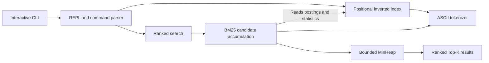

# MiniSearch

[](https://github.com/mertcnkksy/minisearch/actions/workflows/ci.yml)

[](LICENSE)

MiniSearch is an in-memory document search engine written in C++20. It implements a
positional inverted index, Okapi BM25 scoring, and heap-based Top-K retrieval directly.
The core uses custom data structures and standard C++ components. The interactive CLI
indexes text and local files, retrieves ranked results, and reports corpus statistics.

## Quick Start

Install Git, a C++20 compiler, CMake 3.24 or newer, and Ninja. The project is verified
on Linux with GCC and Clang.

```sh
git clone https://github.com/mertcnkksy/minisearch.git
cd minisearch
cmake --preset release-cli
cmake --build --preset release-cli
./build/release-cli/minisearch
```

The `release-cli` preset uses `build/release-cli` and disables tests, sanitizers, and
fuzzing. The test-enabled `release` and `debug` presets use separate build directories.
For a test-enabled build, CMake fetches GoogleTest 1.15.2 and checks the archive's
SHA-256. GoogleTest is used by the tests.

## Interactive CLI demo

After the Quick Start, run this from the repository root. The third document is
loaded from an ASCII text file whose path contains a space. To enter the same
document directly in the REPL, replace the `index` command with `add Database systems`.

```sh
(
    set -eu
    cli="$PWD/build/release-cli/minisearch"
    demo_dir="$(mktemp -d)"
    trap 'rm -rf -- "$demo_dir"' EXIT
    cd "$demo_dir"
    mkdir documents
    printf 'Database systems\n' > 'documents/database notes.txt'
    "$cli" <<'COMMANDS'
add Python Python Python
add Python supports data structures and algorithms
index documents/database notes.txt
search --top 2 python
stats
exit
COMMANDS
)
```

```text
MiniSearch
In-memory document search engine.
Type 'help' for available commands.

minisearch> Indexed document 0.
minisearch> Indexed document 1.
minisearch> Indexed document 2.
minisearch> Rank  Doc ID  Score
1     0       0.768519
2     1       0.372921

Returned 2 results.
minisearch> Documents:      3
Unique terms:   8
Total tokens:   11
Avg. length:    3.666667
minisearch>
```

### Command reference

Run `./build/release-cli/minisearch --help` for startup usage and
`./build/release-cli/minisearch --version` to print `minisearch 0.1.0`.

| Command | Behavior |
| --- | --- |
| `add <text>` | Index an ASCII text document. |
| `index <path>` | Index a local plain-text file. |
| `search <query>` | Retrieve up to 10 BM25 matches. |
| `search --top K <query>` | Retrieve up to K matches. |
| `search -- <query>` | End option parsing. For example, `search -- -python` searches for `python`. |
| `stats` | Show document count, unique terms, total tokens, and average document length. |
| `help` | List the session commands. |
| `exit`, `quit` | End the session and discard the index. |

`K` is an unsigned decimal integer that fits in `size_t`. Signs, missing or partial
numbers, and overflow cause a recoverable error. A limit of zero validates the ASCII
query and returns no results without looking up postings. `SIZE_MAX` is accepted as
its decimal value on the current platform, and returns all matches. The CLI also
accepts `search --top K -- <query>`.

Command names are lowercase. Document contents and queries must be ASCII. Quotes
are ordinary query bytes, and words such as `AND` and `OR` are ordinary terms. File
paths are taken literally with edge spaces and tabs trimmed. Use internal spaces
without quotes, and use Unicode path names where the platform's native narrow path
encoding supports them. Each process starts an empty index with document ID zero.

The CLI permits up to 1 MiB (1,048,576 bytes) per command line before LF and up to
16 MiB (16,777,216 bytes) per indexed file. These are per-input limits. The corpus
and transient indexing and search buffers also use memory. File indexing assumes a
trusted local filesystem.

Recoverable command errors go to stderr and the session continues. Exit status
`0` indicates normal exit, EOF, help, or version output. Status `1` indicates a fatal
runtime, allocation, or stream failure. Status `2` indicates invalid startup arguments.
See [ADR 0009](docs/adr/0009-interactive-cli.md) for the full CLI contract.

## Architecture



### How indexing and ranking work

- **Tokenization.** One tokenizer splits ASCII letters and digits into alphanumeric
  runs. It lowercases letters and records zero-based token positions and half-open byte
  offsets. Bytes above `0x7f` are rejected. [Tokenizer ADR](docs/adr/0005-ascii-tokenizer.md)
- **Indexing.** The term dictionary maps normalized terms to stable internal term IDs.
  Each posting records a stable document ID and its token positions. Term frequency
  (TF) is the per-document occurrence count, document frequency (DF) counts documents
  containing the term, and collection frequency (CF) counts occurrences across the
  corpus. Average length is total tokens divided by document count, or zero for an
  empty corpus. Failed insertion preserves logical index contents and ID continuity.
  [Inverted index ADR](docs/adr/0006-positional-inverted-index.md)
- **Scoring.** BM25 normalizes, sorts, and deduplicates query terms, then visits their
  posting lists and accumulates scores only for matching documents. Positive IDF is
  `ln(1 + (N - DF(t) + 0.5) / (DF(t) + 0.5))`, where `N` counts documents. The term
  contribution is `IDF(t) × TF × (k1 + 1) / (TF + k1 × (1 - b + b × DL / AvgDL))`.
  With defaults `k1 = 1.2` and `b = 0.75`, the formula saturates term frequency and
  normalizes document length `DL` against corpus average `AvgDL`. Scores measure
  ranking relevance. [BM25 ADR](docs/adr/0007-bm25-ranking.md)
- **Selection.** The heap retains at most `H = min(K, C)` of the `C` scored candidates.
  A better candidate replaces the worst retained candidate at the root. Results are
  returned in descending score order, with smaller document IDs first on exact ties.
  [Top-K ADR](docs/adr/0008-top-k-retrieval.md)

### Custom data structures

| Structure | Design and use |
| --- | --- |
| [DynamicArray](docs/adr/0002-dynamic-array.md) | Contiguous storage with geometric growth for posting positions, score arrays, and heap nodes. Supports trivially copyable, default-constructible, unqualified object types. Reallocation invalidates iterators and references. Failed growth preserves the prior array. |
| [HashTable](docs/adr/0003-open-addressing-hash-table.md) | Open addressing with linear probing and tombstones for the term dictionary and sparse score map. Grows above 75% live load and can rebuild at the same capacity to reclaim tombstones. Rehash copies live entries using cached hashes. |
| [Binary MinHeap](docs/adr/0004-binary-min-heap.md) | Array-backed heap with a stable, nonthrowing ordering policy. The span constructor uses Floyd's linear bottom-up heap construction. Ranked search uses incremental pushes with the worst retained candidate at the root. |

### Complexity

Let `B` be input bytes, `T` tokens, `U` unique input terms, `L` maximum term
length, `M` postings visited, `C` matching candidates, `K` requested results,
and `H = min(K, C)`. For the container rows, `n` is the number of elements,
`Q` and `Q'` are the old and replacement bucket capacities, and per-element
operations are treated as constant time.

| Operation | Cost |
| --- | --- |
| DynamicArray access and append | Access O(1). Append amortized O(1) with geometric growth and O(n + 1) when growing. |
| HashTable lookup and rebuild | Expected O(1) lookup probes, worst-case O(Q). Rebuild takes expected O(Q + Q') work, with up to O(n²) additional probes under clustering. String keys add hashing, equality, and copying costs. |
| MinHeap operations | Top O(1). Push and pop O(log(n + 1) + 1) with reserved capacity, with O(n + 1) on a growing push. Bottom-up construction O(n + 1). |
| Tokenization | O(B) time and O(B + T) space for owned tokens, plus constant bookkeeping. |
| Document indexing | O(B + T + U) expected without corpus storage growth. A growing insert can move existing lengths or posting records and rehash the dictionary. |
| Posting lookup | A term of length `l` takes expected O(l + 1), up to O((l + 1) × Q) with collisions. The returned span borrows the list. |
| BM25 candidate generation | Expected O(B + L × T log(T + 1) + U + M + 1), including term sorting and amortized sparse accumulation. Collisions can increase dictionary and row-map costs. Candidate storage is O(C). |
| Top-K selection and extraction | For H ≥ 1, selection takes O(C log(H + 1)), extraction takes O(H log(H + 1)), and heap and result storage are O(H) each. The selector returns immediately at H = 0. |
| End-to-end search memory | Peak additional space O(B + T + C + H + 1), including query tokens, candidate storage, heap, and results. At K = 0 only query validation and tokenization are required. |

See [Architecture](docs/ARCHITECTURE.md) and the linked decision records for growth and
collision bounds.

## C++ library usage

Save this as `search_example.cpp` or see the [C++ examples](examples/README.md) for
the data structures, tokenizer, posting lookup, and raw BM25 scoring.

```cpp
#include "minisearch/index/inverted_index.hpp"
#include "minisearch/search/search_engine.hpp"

#include <iomanip>
#include <iostream>

int main() {
    minisearch::InvertedIndex index;
    index.add_document("Database systems");
    index.add_document("Python supports data structures and algorithms");
    index.add_document("Python Python Python");

    for (const auto &result : minisearch::search(index, "PYTHON", 2)) {
        std::cout << result.document_id << ' ' << std::fixed << std::setprecision(6)
                  << result.score << '\n';
    }
}
```

Compile from the repository root after the Quick Start with the same compiler used
to build the core.

```sh
c++ -std=c++20 -I include search_example.cpp build/release-cli/libminisearch_core.a -o build/release-cli/search_example
./build/release-cli/search_example
```

```text
2 0.768519
1 0.372921
```

## Testing and verification

```sh
cmake --preset debug
cmake --build --preset debug
ctest --preset debug
```

The Linux suite has 163 CTest cases, including a 24-document golden corpus, an
independent reference model, stateful and metamorphic checks, and allocation and
I/O regressions. CI builds and tests GCC and Clang in Debug, Release, and ASan +
UBSan configurations. Three opt-in libFuzzer targets exercise the tokenizer,
command parser, and search pipeline. See [Testing](docs/TESTING.md) for the
verification commands and how to interpret the results.

## Project structure

```text
include/minisearch/   Public headers for data structures, text, index, ranking, search, and CLI
src/                  Core library, CLI modules, and executable entry point
tests/                Unit, integration, allocation, and executable tests
tests/fuzz/           libFuzzer harnesses and input seeds
examples/             C++ API examples
docs/                 Architecture, testing, and architecture decision records
scripts/              Formatting and coverage tools
.github/workflows/    CI builds, tests, and static checks
```

## Current limitations

- The append-only index and its document IDs are session-local. There is no
  persistence, document deletion or update, or concurrent indexing.
- Documents and queries use ASCII tokenization. There is no Boolean or phrase
  retrieval, stemming, stopword filtering, or fuzzy matching.
- All matching candidates are scored for a positive limit. There is no score-based
  posting pruning. Floating-point rounding may differ across platforms.
- The interface is a terminal session. There is no HTTP API or graphical interface.
- File indexing assumes trusted local files. Per-input byte limits do not bound
  total session memory.

## Roadmap

The v0.1.0 MVP delivers in-memory indexing and ranked search. The v0.2.0
Query Engine milestone plans Boolean and phrase search, Unicode analysis,
and retrieval evaluation. See the [roadmap](ROADMAP.md) and [changelog](CHANGELOG.md).

## Contributing and license

See [Contributing](CONTRIBUTING.md) for development checks and contribution guidelines.
MiniSearch is available under the [MIT License](LICENSE).
