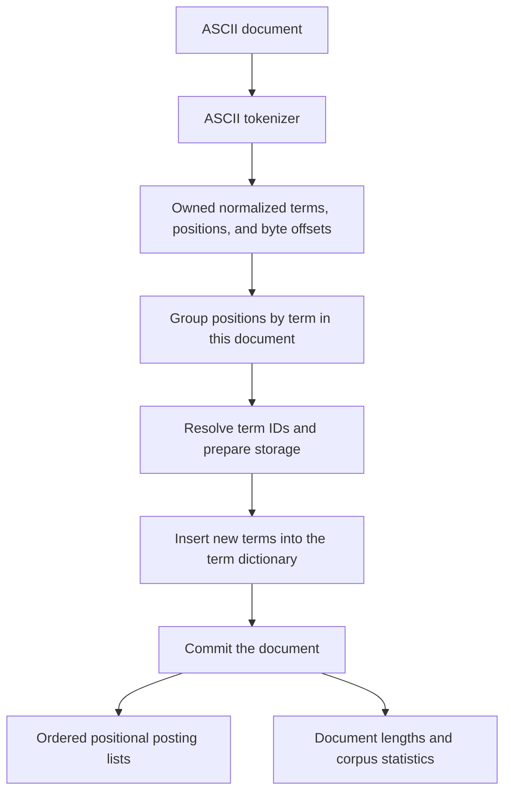
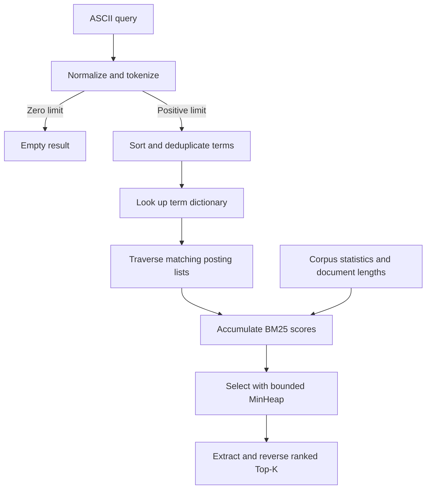
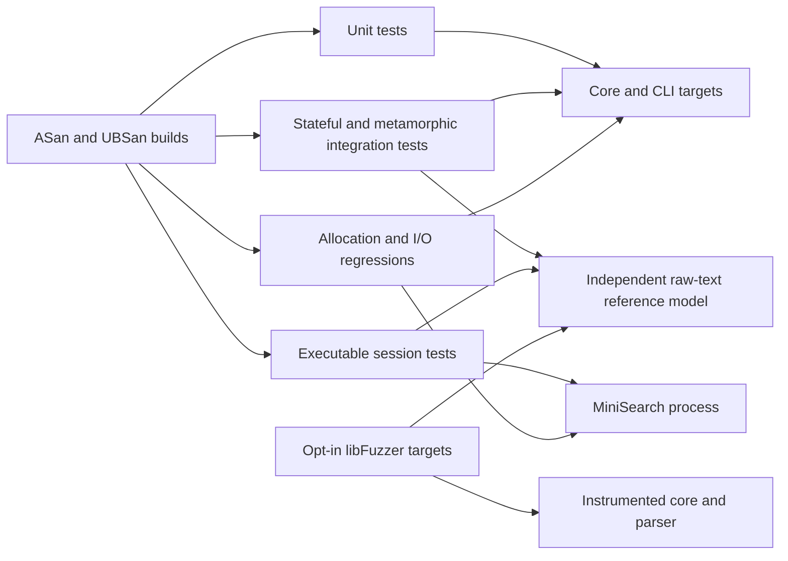

# Architecture

MiniSearch is a C++20 library and terminal application. The `minisearch` executable
handles startup arguments and delegates the session to `minisearch_cli`. That target
handles bounded command and file reading, owns the session's index, and formats
results. It links to `minisearch_core`, which publishes the include directory and
C++20 requirement. The core owns the tokenizer, positional index, BM25 scorer,
and Top-K retrieval and has no terminal dependency.

## Document indexing

The dictionary maps terms to stable internal IDs. Each posting owns a document ID
and a DynamicArray of zero-based positions. Posting lists are ordered by increasing
document ID. The index retains lengths and statistics for scoring. The tokenizer's
byte offsets are available to callers of the tokenizer. Posting lists retain token
positions.

Insertion stages the new document and reserves growth before committing postings and
statistics. If dictionary insertion fails, it erases the newly inserted dictionary
entries without allocating. A failed insertion preserves logical index state. Posting
views must be acquired again after any insertion attempt.

## Ranked search

Both the BM25 scorer and ranked search call the same candidate accumulator. It
looks up each unique term, calculates its positive IDF from corpus and posting
counts, and walks the posting list to add a contribution for each matching
document. A hash table maps document IDs to rows of the score array.
`BM25Scorer::score_query` sorts the resulting array by document ID. The ranked
`search` path passes the unsorted candidates directly to the heap selector.

The ranked path scores all candidates for positive K. Of C candidates the heap
retains at most H = min(K, C). The root is the worst retained candidate, using
lower score first and larger document ID first on exact ties. Popping and
reversing yields the desired ranking. A zero limit still validates the query
but skips dictionary lookup and score accumulation.

With well-distributed hashes, the posting walk has expected O(M) accumulation
cost for M visited postings, in addition to tokenization, term comparisons,
and term hashing. Candidate storage is O(C). For H ≥ 1, heap selection takes
O(C log(H + 1)), and extraction takes O(H log(H + 1)). Heap and result buffers
each use O(H) storage. Peak additional search space is O(B + T + C + H + 1) for
B query bytes and T tokens. See [ADR 0008](adr/0008-top-k-retrieval.md) for the
dictionary, string comparison, and collision costs.

## Test architecture

The core and session tests use GoogleTest. CTest discovers them and also runs
subprocess tests against the executable. The C++ reference model is used by
tests and fuzzers. Fuzzing compiles separate instrumented core and parser targets
and links libFuzzer into the harnesses. See [Testing](TESTING.md) for verification.

## Design records

- [ADR 0001](adr/0001-project-architecture.md) covers CMake target boundaries.
- [ADR 0002](adr/0002-dynamic-array.md), [ADR 0003](adr/0003-open-addressing-hash-table.md),
  and [ADR 0004](adr/0004-binary-min-heap.md) cover type requirements, exception
  guarantees, invalidation, and operation costs for the custom containers.
- [ADR 0005](adr/0005-ascii-tokenizer.md) defines token positions and offsets.
- [ADR 0006](adr/0006-positional-inverted-index.md) covers index storage, insertion
  rollback, and complexity.
- [ADR 0007](adr/0007-bm25-ranking.md) covers BM25 and its numeric contract.
- [ADR 0008](adr/0008-top-k-retrieval.md) covers ranked retrieval and exact ties.
- [ADR 0009](adr/0009-interactive-cli.md) covers CLI grammar, I/O, and resource limits.

The [roadmap](../ROADMAP.md) records the planned v0.2.0 UTF-8 validation, Unicode
tokenization, ICU integration, NFC normalization, and Turkish language support.
